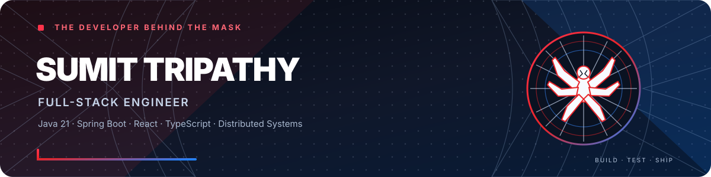

**FULL-STACK ENGINEER · JAVA · SPRING BOOT · REACT**

*"With great code comes great responsibility."*

---

## 🕸️ Hey, I'm Sumit Tripathy

I'm a **Senior Software Engineer at Capgemini** in Bengaluru, India, with **2+ years** of experience building enterprise web applications. I work across the stack: responsive React interfaces, Java/Spring Boot services, API integrations, asynchronous workflows, and cloud-native delivery.

Today I lead a squad on an identity-verification (eKYC) platform serving **95,000+ users**, and I stay hands-on with the code. I care about **reliable systems, secure APIs, maintainable architecture, and user experiences that make complex workflows feel simple**.

**I'm open to full-stack and backend engineering roles** where I can keep learning and build useful products with a strong team.

## 🕷️ By the Numbers

| **95,000+** | **8** | **90%+** | **8** |
|:---:|:---:|:---:|:---:|
| Users served in Vietnam | Engineers led in a squad | Unit-test coverage | Deployment environments |

## 🧰 My Engineering Toolkit

**Languages**  

**Backend & APIs**  

**Frontend & Testing**  

**Data, Messaging & Delivery**  

## 💼 Professional Experience

### Senior Software Engineer · Capgemini — 2026 – Present
**IDV eKYC Platform · Vietnam** · Java 21, Spring Boot, React 19, TypeScript, Oracle/JPA

- Lead a squad of 8 delivering a secure, five-stage identity-verification lifecycle serving 95,000+ users in Vietnam.
- Designed onboarding and payment flows with Strategy-based handlers and a three-level route resolver backed by Oracle/JPA.
- Built a Redux-driven React webview (micro-frontend via Webpack 5 Module Federation) with native-bridge launch, consent handling, and resumable retries.
- Resolved an asynchronous transaction race condition and implemented Vault credential rotation with live database-pool updates and zero restarts.
- Reached 90%+ unit-test coverage across 91 test files and supported deployments to 8 environments using Docker, Helm, and Azure DevOps.

### Software Engineer · Capgemini — 2024 – 2026
**Digital Account Opening (CASA) · Hong Kong** · Java 21, Spring Boot, GraphQL, React 19, Oracle, Solace JMS

- Developed a GraphQL backend for a six-stage account-opening journey.
- Built a multi-pod-safe screening scheduler using conditional database updates to prevent duplicate processing.
- Designed an asynchronous pipeline integrating six downstream systems, with isolated thread pools and stage-level audit logging.
- Implemented SHA-256 request-integrity checks and centralized GraphQL exception handling.
- Built a React form engine with 17 server-driven field types, HKID validation, session recovery, and 40+ mapped IDV error codes.

## 🕷️ Featured Projects

### 🧾 Order Management System
A full-stack e-commerce system organized around Auth, Order, Inventory, Notification, and Payment services. Includes JWT authentication, service-to-service communication, Kafka-driven order/payment events, Resilience4j patterns, and isolated PostgreSQL databases.  
`Java` · `Spring Boot` · `Kafka` · `PostgreSQL` · `Docker`  
*Source repository is currently private.*

### 🌐 Portfolio Website
My personal portfolio, live on Netlify.  
`HTML` · `CSS` , `JavaScript` ,  `React Js`
[Live site](https://sumittripathy.netlify.app/) · [Source code](https://github.com/sumittripathy40/My-Portfolio)

### 🎬 Netflix Landing Page Clone
A front-end recreation of the Netflix landing page: hero section, feature highlights, FAQ layout, and footer.  
`HTML` · `CSS` , `JavaScript` ,  `React Js`
[Live demo](https://sumittripathy40.github.io/NETFLIX-CLONE/) · [Source code](https://github.com/sumittripathy40/NETFLIX-CLONE)

<b>More projects: learning and experiments</b>

 

- 🩺 **[Breast Cancer Prediction](https://github.com/sumittripathy40/Breast-Cancer-Prediction)**: Jupyter notebook on the Wisconsin breast cancer dataset covering feature scaling, K-Nearest Neighbors classification, model evaluation, and cross-validation. *Python · Pandas · NumPy · scikit-learn · SciPy*
- 🎓 **[Student Management System](https://github.com/sumittripathy40/Student-Management-System)**: command-line app for student and teacher records with separate admin, teacher, and student menu flows and local text-file storage. *Python · File I/O*
- 📈 **[Stock Prediction Using Machine Learning](https://github.com/sumittripathy40/stock-prediction-using-machine-learning-)**: machine-learning notebook focused on stock prediction.

## 🧠 What I Value in Engineering

- **Reliability:** handle retries, edge cases, and asynchronous processing intentionally.
- **Security:** prioritize API integrity, authentication, and safer credential handling.
- **Maintainability:** write clear abstractions and automated tests that help teams move confidently.
- **Delivery:** pair strong implementation with observability, CI/CD, and practical ownership.

---

Spider-Verse-inspired styling created for this profile. Unofficial fan-inspired theme; not affiliated with or endorsed by Marvel.
